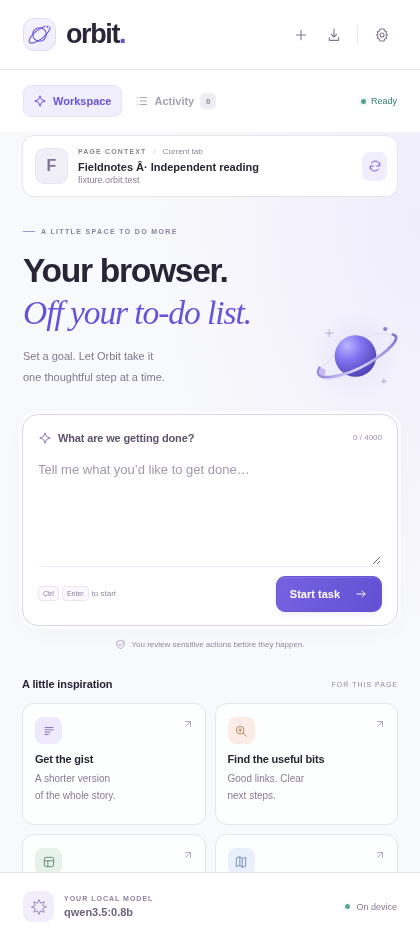

# Orbit · Local Browser Agent

A Chrome side-panel agent for reading websites and carrying out small browser tasks with **Qwen3.5 0.8B through Ollama**. It includes a complete extension, a bounded agent loop, local model settings, action review, and an activity log. No hosted backend, runtime npm dependencies, API key, or remote scripts.

[Download the extension ZIP](orbit-chrome.zip), extract it, and load the extracted directory in Chrome.



## Install in Chrome

1. Open `chrome://extensions`, enable **Developer mode**, and choose **Load unpacked**.
2. Select this project's **`extension/` directory**. If using the ZIP, extract it and select the folder containing `manifest.json`.
3. Pin Orbit in Chrome's extensions menu. Click its icon to open the side panel.
4. Open Settings in Orbit. Pull the model in a terminal:

   ```sh
   ollama pull qwen3.5:0.8b
   ```

5. Copy the exact startup command shown under **First time with Ollama?**. Stop the existing Ollama server before restarting it with that command. The command allows this extension's specific origin:

   ```sh
   OLLAMA_ORIGINS="chrome-extension://YOUR_EXTENSION_ID" ollama serve
   ```

   On Windows PowerShell, set the variable before starting:

   ```powershell
   $env:OLLAMA_ORIGINS="chrome-extension://YOUR_EXTENSION_ID"
   ollama serve
   ```

   On macOS with the Ollama desktop app, use `launchctl setenv OLLAMA_ORIGINS "chrome-extension://YOUR_EXTENSION_ID"`, then quit and reopen Ollama. Use a current Ollama version that supports this model, structured output, and `think: false`.

6. Click **Save & connect**. Open a website, choose **Enable website access**, and enter a task. **Ctrl/Cmd + Enter** starts a task. **Stop** cancels model generation and prevents subsequent actions. Keep the panel visible while a task runs.

Ollama must run on the computer running Chrome. The cloud machine's loopback server is not reachable from your laptop's Chrome extension. You can develop and package the extension here, then load it into your own browser.

Try: “Search this site for wireless keyboards and report the first three results,” “Summarize this page,” or “Fill the search field with train tickets and run the search.” Start with one clear, short task.

## What it does

- Reads visible page text and up to 40 visible interactive controls per step.
- Types into text fields and textareas, chooses dropdown options, clicks links and buttons, scrolls, goes back, opens web addresses, and extracts page text.
- Keeps the task pinned to its original tab. Ordinary links that would open another tab stay in that tab.
- Shows each planned action and its result. You can export the current session as JSON.
- Requires one-time approval for recognized submissions, purchases, account changes, downloads, personal-data fields, and unknown buttons.
- Leaves passwords, one-time codes, payment credential fields, file uploads, and hidden controls to you.
- Checks page identity and control identity again before acting; stops on repeated actions, repeated errors, timeouts, or its step budget.

## Designed for a small model

The Ollama adapter uses a flat JSON schema with nine actions, deterministic generation, disabled thinking, a bounded output, compact DOM observations, five recent action records, and a single repair attempt for malformed JSON. The default context is 8,192 tokens and the task budget is 16 steps. Both are configurable. There is no second paid model behind the scenes.

These choices reduce the model's tool-use burden. Real Qwen reliability and speed still need to be measured on the target computer. A 0.8B model is best suited to short, explicit tasks; a larger installed Ollama model can be selected in Settings for harder work.

## Boundaries

This is a functional first version, not a benchmarked replacement for Manus. It operates on the main page's DOM. Cross-origin frames, closed shadow roots, canvas interfaces, visual-only controls, CAPTCHAs, browser internal pages, the Chrome Web Store, and websites requiring trusted physical input are unsupported. It does not browse in the background after its panel is closed or hidden. It does not have screenshot vision, multi-agent orchestration, a remote desktop, or a general JavaScript execution tool.

Action review uses conservative labels and form metadata. It cannot determine every possible side effect of arbitrary website code. Review consequential workflows and use it on sites you trust. Website text is marked as untrusted data in the agent prompt; this is defense in depth rather than a guarantee against prompt injection.

Only settings persist automatically. Task transcripts remain in memory unless you export them. No cookies or passwords are read by the extension. The local model receives page URLs, visible text, control labels, and task/action history; do not use sensitive pages unless you intend that data to go to your local Ollama process.

## Develop and test

Node 20+ and npm are needed for development tests, not for loading the extension. Each cloud task already has an isolated workspace: use this directory directly; do not create a Git worktree.

```sh
cd browser-extension
npm ci --ignore-scripts
npm test
npm run test:browser
npm run package
```

Browser tests use Playwright and Chromium. Set `CHROMIUM_PATH` to a compatible browser executable if necessary, or install Playwright's Chromium with `npx playwright install chromium`. The normal browser test loads an unpacked extension in a temporary profile, grants only the local fixture's origin in a temporary test manifest, and runs against a fixture Ollama API. It never makes a real purchase or contacts a live website.

If cloud browser management blocks extension installation, run:

```sh
ORBIT_WEB_HARNESS=1 npm run test:browser
```

That mode serves the same panel and modules over HTTP and adapts Chrome APIs to a real browser fixture through Playwright. It verifies DOM actions and agent/UI integration; **it does not verify native extension installation, side-panel behavior, or Chrome permission prompts**. It never changes managed browser policies.

Tests cover schema decoding, streaming, approval gates, secret fields, cancellation, loop limits, typing, dropdowns, page reading, and form submission. Screenshots and a machine-readable result are written to `test-results/`.

`npm run package` writes `dist/orbit-chrome-0.1.0.zip`. Chrome loads it after extraction; this is not a signed Chrome Web Store package.

## Validation in this cloud machine

- Core tests and real-browser web-harness checks are available and run during development.
- Native extension installation is blocked by the machine's managed Chromium extension policy.
- Live Qwen inference is pending access to the Ollama model registry. Fixture API tests are not model-quality validation.

## Source map

| File | Purpose |
| --- | --- |
| `extension/manifest.json` | Manifest V3, optional website permissions, localhost model access |
| `extension/panel.*` | Side panel, settings, task feed, approval flow |
| `extension/lib/agent.js` | Observe → decide → review → act loop |
| `extension/lib/ollama.js` | Local streaming API and constrained decoding |
| `extension/lib/page.js` | Isolated-world DOM observation and actions |
| `extension/lib/driver.js` | Native Chrome tab and script execution |
| `extension/lib/protocol.js` | Action schema, prompt, URL validation, review policy |

This extension lives in `browser-extension/`. The original LLM Selector application files are unchanged.
